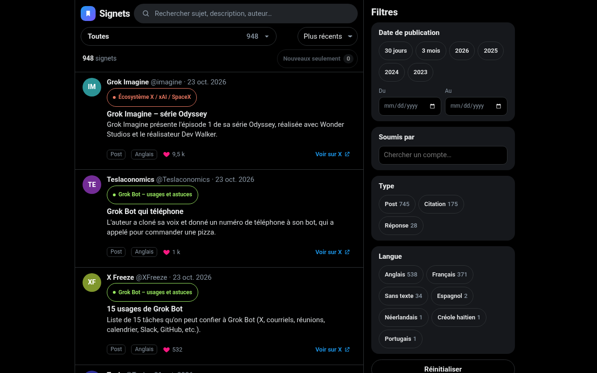
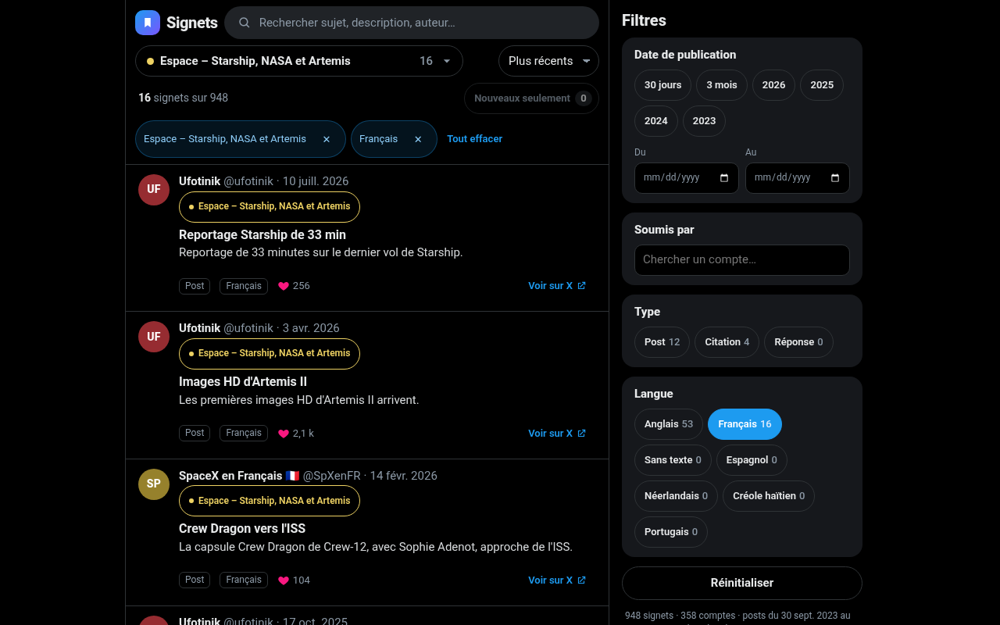
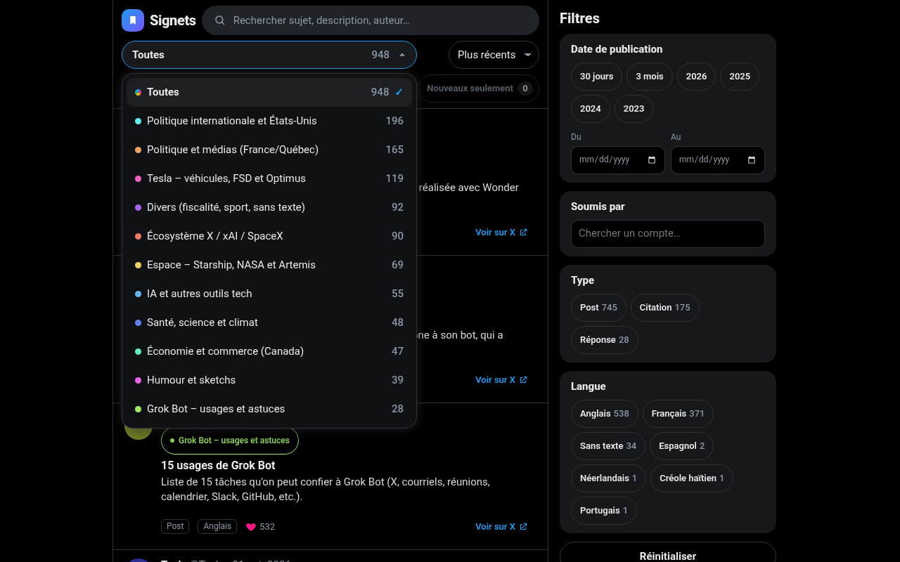
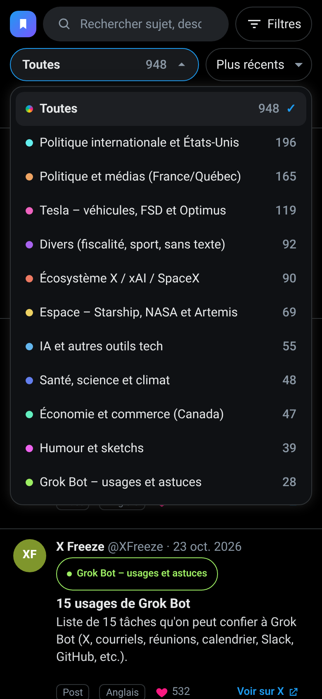
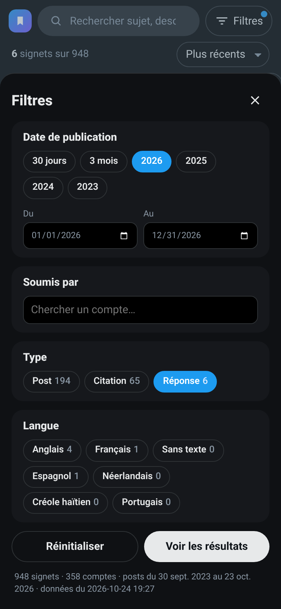
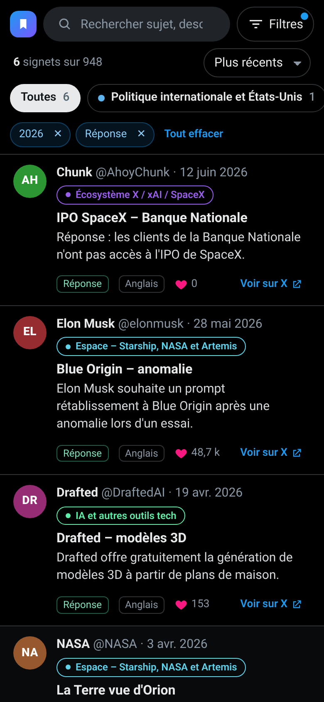
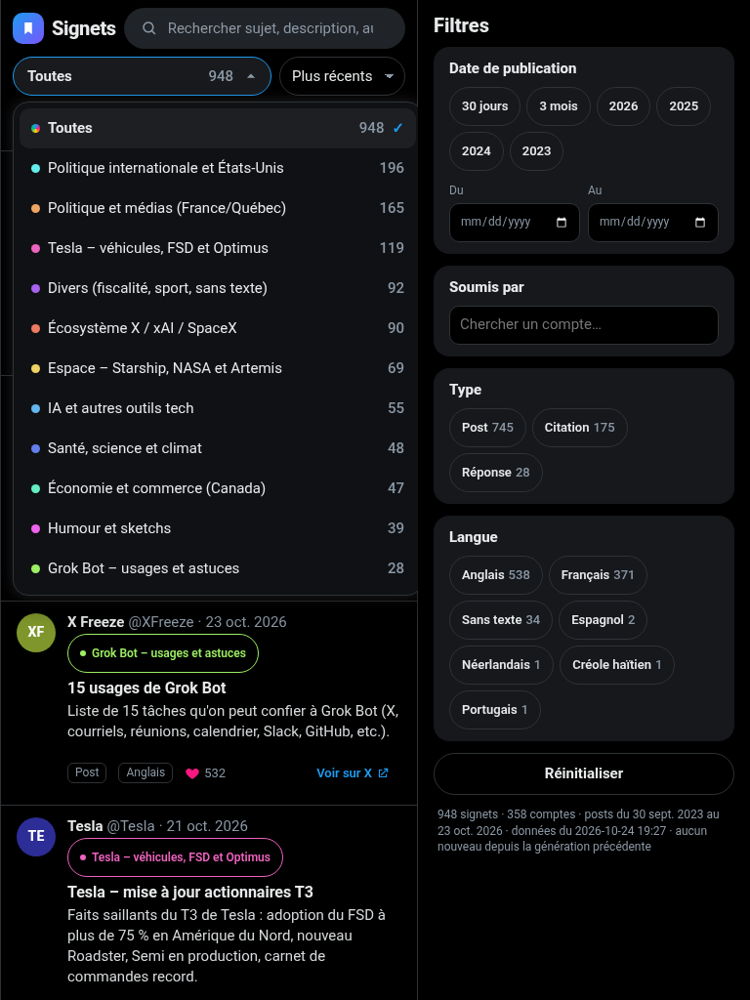

# proto-signets-x — Signets

Un fil sombre, inspiré de X, qui présente les **948 signets X de Guy** sous forme de cartes, avec des filtres pour retrouver vite un post.

**Site en ligne :** https://guygtr.github.io/proto-signets-x/



## L'idée

Les signets X s'accumulent et deviennent vite introuvables. Ce prototype les affiche comme un fil de posts : avatar (initiales du compte), nom et @compte, date, catégorie, sujet, brève description, type, langue, nombre de J'aime et un lien « Voir sur X » qui ouvre le post dans un nouvel onglet.

Aucun logo officiel de X n'est utilisé : la marque « Signets » est une création neutre.

### Filtres

- **Catégorie** : une liste déroulante (« Toutes (948) » puis chaque catégorie avec sa pastille de couleur et son nombre de signets). Les nombres suivent les autres filtres. Utilisable à la souris, au toucher et au clavier (↑ ↓, Début, Fin, Entrée, Échap, première lettre). Cliquer la catégorie d'une carte règle aussi la liste.
- **Date de publication** : du / au, et raccourcis (30 jours, 3 mois, 2026, 2025, 2024, 2023)
- **Soumis par** : liste de comptes avec recherche (358 comptes)
- **Recherche texte** dans le sujet, la description et le compte (sans tenir compte des accents)
- **Type** (Post, Citation, Réponse) et **Langue**
- **Tri** : plus récents, plus anciens, plus aimés
- Nombre de résultats, filtres actifs effaçables un à un, bouton Réinitialiser
- Les filtres sont gardés dans l'URL : on peut partager ou mettre en favori une vue filtrée
- Affichage par lots de 30 avec « Charger plus » pour rester rapide

Sur mobile, la liste des catégories reste sous la barre de recherche et les autres filtres s'ouvrent dans un tiroir. Testé à 1280×800 (bureau), 768 px (tablette) et 390×844 (mobile) : aucun débordement, liste entièrement visible.

### Catégories 100 % dynamiques

Le bot X Signets peut ajouter, renommer ou retirer des catégories. Rien n'est codé en dur : la liste, les nombres et les couleurs sont calculés à partir de `data/signets.json` à chaque chargement.

- Couleur stable par nom : chaque catégorie choisit une teinte dans une palette contrastée grâce à un hash de son nom (une teinte calculée sert de repli s'il y a plus de catégories que de couleurs).
- Un signet sans catégorie est classé dans « Sans catégorie ».
- Si un lien partagé pointe vers une catégorie qui n'existe plus, le site revient simplement à « Toutes ».





| Mobile | Liste des catégories | Tiroir de filtres | Filtre appliqué |
|---|---|---|---|
|  |  |  |  |

Tablette (768 px) : 

## Source des données

Le fichier Excel `Signets_X.xlsx` tenu par le bot **X Signets** (sur GTR2018 : `C:\Users\gtremblay\Documents\GrokBot\X\Signets_X.xlsx`), feuille « Signets », tableau « Tableau1 ».
Colonnes : Catégorie, Date (date de publication du post), Soumis par (« @compte (Nom affiché) »), Sujet, Brève description, Lien X (clé unique), Type, Langue, J'aime.

Le site lit uniquement `data/signets.json`, généré à partir de l'Excel. L'Excel n'est jamais modifié.

## Lancer en local

Aucun serveur applicatif : c'est un site statique (HTML, CSS, JavaScript).

```bash
python3 -m http.server 8000
# puis ouvrir http://localhost:8000/
```

(Ouvrir `index.html` directement en `file://` ne marche pas, car le navigateur bloque le chargement du JSON.)

## Régénérer le JSON

```bash
pip install openpyxl
python3 scripts/build-data.py /chemin/vers/Signets_X.xlsx
```

Sans argument, le script lit `/workspace/x_signets/Signets_X.xlsx`. Il écrit `data/signets.json`, trie par date (plus récent d'abord) et ignore les doublons de lien. Il ne contient aucune liste de catégories : il recopie celles de l'Excel telles quelles.

## Tests

`scripts/test-site.py` (Playwright + Chrome) vérifie le total de 948, chaque filtre (dont la liste des catégories au clic, au toucher et au clavier), le tri, l'URL, l'absence de débordement à 1280, 768 et 390 px, le pied de page, et refait les captures. Il charge aussi une version modifiée du JSON en mémoire (une catégorie retirée, une ajoutée, un signet sans catégorie) pour prouver que la liste est dynamique ; rien n'est écrit sur le disque.

```bash
python3 scripts/test-site.py http://localhost:8000/ screenshots
```

## Prochaines étapes (idées)

- **Mise à jour hebdomadaire** : l'Excel grossit chaque lundi vers 8 h. On pourrait régénérer le JSON et republier le site chaque semaine. *Pas encore approuvé.*
- Aperçu des médias ou du texte original des posts
- Statistiques (signets par mois, comptes les plus présents)
- Exporter une vue filtrée en CSV

---

© GTR Technologies Inc. · Tous droits réservés.
Site réalisé par la GTR-Teams
